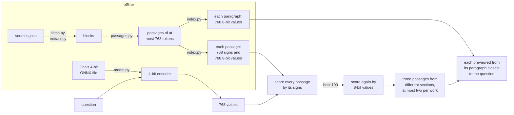

# philosophical search

[philosophical search](https://gustavecortal.com/philosophical-search/) is a semantic search over passages from philosophy books, encyclopedias and Wikipedia. The [live demo](https://gustavecortal.com/philosophical-search/) runs in the browser, and this repository builds its corpus, encoder and index, and searches the index from the command line as the page does.

<p align="center">
  <a href="https://gustavecortal.com/philosophical-search/"></a>
</p>

## Quick start

With [uv](https://docs.astral.sh/uv/getting-started/installation/), which installs each script's dependencies, build an index of three public-domain books and ask it a question:

```bash
git clone https://github.com/gustavecortal/philosophical-search.git
cd philosophical-search
uv run fetch.py --only se-hume-enquiry se-plato-meno se-epictetus-enchiridion
uv run extract.py && uv run passages.py && uv run model.py && uv run index.py
uv run query.py "Can virtue be taught?"
```

This takes about three minutes on a desktop processor (an Intel Core i5-14400F), most of it to embed the 183 passages and their paragraphs. The first run also downloads the encoder twice: 424 MB of weights for `index.py` and the 138 MB ONNX file `model.py` starts from.

`query.py` prints the three passages the page would show first, each from its paragraph closest to the question. It runs the 4-bit encoder the page runs on WebGPU. Without a GPU, the page runs an 8-bit conversion of it, whose first results can differ slightly. `--groups 2` adds the next three, as Show more does, `--whole` prints each passage from its start, and `--keyword` ranks the reviewed passages by BM25, as the page does on a device that cannot run the model. `uv run test.py` checks the search against the page's code.

## How it works



The 145,574 passages come from public-domain books (Standard Ebooks, Project Gutenberg and Wikisource), every entry of the Stanford Encyclopedia of Philosophy and the Internet Encyclopedia of Philosophy, and the Wikipedia articles that WikiProject Philosophy rates of top, high or mid importance. `sources.json` pins each of these 6,586 documents to a commit, revision or archive edition. `extract.py` splits each into paragraphs, dialogue turns, quotations and verse, leaving out editors' introductions, notes and bibliographies. Claude selected 524 passages and wrote the questions each addresses, and two independent reviews checked every choice. `reviewed.jsonl` keeps their first and last blocks and a hash of their text. `passages.py` cuts the rest of each section into passages of at most 768 tokens, of about equal length.

`index.py` embeds every passage, and each of its paragraphs, with [jina-embeddings-v5-text-nano-retrieval](https://huggingface.co/jinaai/jina-embeddings-v5-text-nano-retrieval) in float32: "Document: " before the text, the last token's vector, normalized. It stores each vector twice, as its signs (one bit per dimension, 14 MB in all, which the page downloads with the model) and as 8-bit values with a scale (507 MB, which the page reads by HTTP range).

The page encodes the question with the same model, quantized to 4 bits, after "Query: ". A first pass scores every passage by its signs: the sum of the question's values, each taken with the sign of the passage's value. The best 100 are then ranked by their 8-bit vectors, which gives the same first result as exact ranking on 60 evaluation questions. These questions were written and judged while the live page was built, and are not in this repository. Passages overlapping a better one from the same work are left out, and each group of three takes the best remaining passages from different sections, at most two from one work. If the first result scores below 0.30, nothing is shown, and below 0.40 the page says the passages match only loosely. Both thresholds come from the same 60 questions. Each passage is previewed from its paragraph closest to the question.

`model.py` makes the page's encoder from Jina's 4-bit ONNX file. It rewrites the token lookup, which ONNX Runtime Web's WebAssembly build cannot run, into standard operators, and keeps the 61,205 of 128,256 tokens that English and French text use (`kept-tokens.txt`), which brings the download from 155 to 106 MB. Neither change alters a vector, and the files it writes are byte for byte those the page serves.

| File | Contents |
|---|---|
| [`fetch.py`](fetch.py) | Downloads the pinned sources |
| [`extract.py`](extract.py) | Splits each source into blocks: paragraphs, dialogue turns, quotations, verse |
| [`passages.py`](passages.py) | Cuts the blocks into passages |
| [`model.py`](model.py) | Makes the page's query encoder |
| [`index.py`](index.py) | Embeds the passages and writes the index files |
| [`query.py`](query.py) | Searches an index as the page does |
| [`sources.json`](sources.json) | The 6,586 documents, pinned, with their licences |
| [`reviewed.jsonl`](reviewed.jsonl) | The 524 reviewed passages, as block ranges and text hashes |
| [`kept-tokens.txt`](kept-tokens.txt) | The tokens the page's encoder keeps |
| [`encoder.json`](encoder.json) | The encoder's revision, file hashes and recipe |

## Rebuild the whole index

```bash
uv run fetch.py
uv run extract.py && uv run passages.py && uv run model.py && uv run index.py
```

Fetching every source should take about three hours, since the Stanford Encyclopedia asks for one request every five seconds, and downloads 1.1 GB. The other sites are fetched meanwhile, one request at a time each. On the same processor, `extract.py` then takes a minute and a half and `passages.py` one minute. `passages.py` prints a hash of the passages' text: the live index's 145,574 passages give `25d7812590c1`. A different hash means a source has changed since the index was built, which can happen to the Gutenberg mirror's files and to IEP entries, since neither is archived.

The scripts keep four known faults of the live pipeline, so that they reproduce its passages, and a comment at each describes it. [Paragraphs inside list items in Standard Ebooks books](extract.py#L240) appear twice. [IEP paragraphs](extract.py#L476) lose their notes and keep "[]" where each note was. In four SEP entries, [a formula right after a heading](extract.py#L417) joins the paragraph before it. [Some sections](passages.py#L35) are cut into one passage more than needed.

`index.py` embeds the passages and their 511,084 paragraphs, about an hour and a half on an Intel Arc A770, and writes 850 MB. Run it on a GPU: PyTorch from PyPI uses NVIDIA GPUs on Linux and Apple's on macOS, and Intel GPUs need [PyTorch's XPU build](https://pytorch.org/get-started/locally/). It writes the index into `data/index/`, where `query.py` reads it. An interrupted run resumes from the vectors saved in `data/embeddings/`. Embeddings computed on another device differ slightly from the live ones (a cosine above 0.9999998 on a CPU), so a few 8-bit values change by one. The signs of the 470 passages compared stayed the same.

## License

The code is under the [MIT license](LICENSE). The index holds the sources' text: Wikipedia's is under [CC BY-SA 4.0](https://creativecommons.org/licenses/by-sa/4.0/), the books are in the public domain in the United States, and the entries of both encyclopedias are copyrighted by their authors, so this repository holds none of their text. jina-embeddings-v5-text-nano-retrieval, and the encoder `model.py` derives from it, are under [CC BY-NC 4.0](https://creativecommons.org/licenses/by-nc/4.0/).
